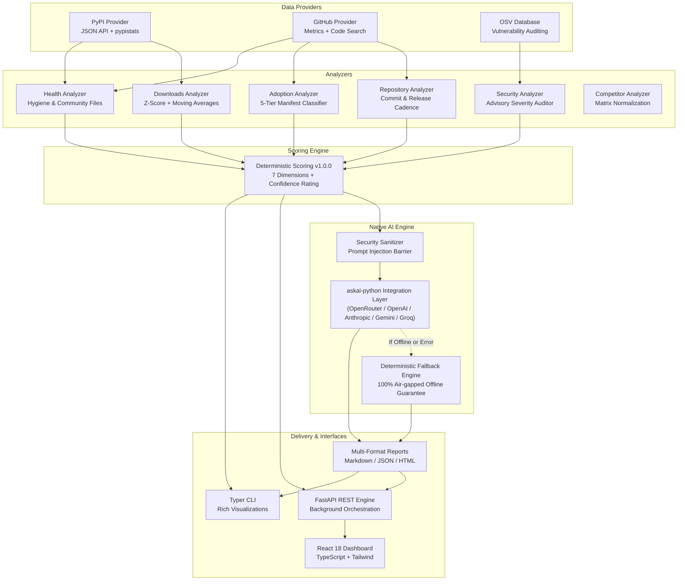

<div align="center">

# LibScope

**Open-Source Software Intelligence. Beyond Downloads.**

[](https://github.com/libscope/libscope/actions)
[](LICENSE)
[](https://python.org)
[](https://pypi.org/project/askai-python/)
[](https://github.com/astral-sh/ruff)

*A production-grade, extensible open-source software intelligence platform that analyzes software packages and repositories, discovers real-world adoption evidence, measures ecosystem health, tracks trends, and produces objective, evidence-based intelligence reports.*

[Features](#features) • [Architecture](#architecture) • [Quickstart](#quickstart) • [CLI Usage](#cli-usage) • [REST API & Dashboard](#web-dashboard--rest-api) • [AI Engine Integration](#ai-engine-integration-askai-python) • [Docker](#docker-deployment) • [Contributing](#contributing)

</div>

---

## The Problem

Software engineering teams and open-source consumers frequently select packages using misleading vanity metrics:
- **Raw download counts** are heavily distorted by automated CI/CD pipelines, mirrors, cloud build agents, and automated bots.
- **GitHub stars** reflect social media virality rather than real-world production reliability.
- **Dormant repositories** appear active due to automated dependabot commits while maintainers have completely moved on.
- **Security vulnerabilities** remain hidden until downstream systems are compromised.

**LibScope** solves this by providing empirical, multi-dimensional software intelligence. It goes **beyond downloads** to verify whether independent projects are actually importing a package, evaluates engineering discipline, scores packages deterministically, and synthesizes structured reports.

---

## Features

- **Empirical Adoption Discovery**:
  Scans public repository manifests (e.g. `pyproject.toml`, `requirements.txt`, `setup.cfg`) and classifies citations into 5 rigorous tiers (`Confirmed dependency`, `Confirmed usage`, `Possible usage`, `Mention only`, `Unverified`), automatically deduplicating citations and filtering self-repositories.

- **Deterministic 7-Dimension Scoring (`v1.0.0`)**:
  Computes fully explainable scores across **Popularity**, **Growth**, **Adoption**, **Maintenance**, **Documentation**, **Quality**, and **Security**. Explicitly indicates `"Insufficient data"` and confidence levels rather than guessing.

- **Download Anomaly & Trend Detection**:
  Calculates 7-day and 30-day moving averages and uses Z-score statistical anomaly detection to distinguish natural growth from bot-driven download spikes. Distinguishes mirror-inclusive vs mirror-exclusive statistics.

- **Engineering Hygiene & OSV Auditing**:
  Inspects commit cadence, release frequency, OSI licenses, documentation completeness (`README`, `CONTRIBUTING`, `SECURITY.md`), and audits open CVEs/GHSAs using the Google Open Source Vulnerabilities (OSV) database.

- **Native AI Analyst Powered by `askai-python`**:
  Integrates `askai-python` for structured interpretation, executive summaries, risk assessments, and maintainer recommendations. Backed by strict prompt injection sanitization and **100% deterministic offline fallback** when AI credentials are absent.

- **Multi-Interface Delivery**:
  - **Terminal CLI**: Rich interactive console with side-by-side package comparisons, table visualizations, and offline benchmarking.
  - **REST API**: Production FastAPI backend with background job orchestration and OpenAPI / Swagger documentation.
  - **Web Dashboard**: Modern Single-Page Application (SPA) built with React 18, Vite, TypeScript, and Tailwind CSS.
  - **Executive Reports**: Multi-format generation in Markdown, JSON, and self-contained interactive HTML.

---

## Architecture

LibScope follows a strictly decoupled, modular architecture designed for high extensibility:



---

## Quickstart

### 1. Installation

```bash
# Clone the repository
git clone https://github.com/libscope/libscope.git
cd libscope

# Create and activate virtual environment
python -m venv .venv
source .venv/bin/activate  # On Windows: .venv\Scripts\activate

# Install libscope with core dependencies
pip install -e .
```

### 2. Run the Offline Demo Benchmark

Verify the entire scoring, comparison, and reporting engine without needing external API tokens:

```bash
# Seed the benchmark dataset (fastapi, requests, askai-python)
libscope demo

# Compare packages side-by-side
libscope compare fastapi requests

# Generate an intelligence report
libscope report 1 --format markdown
```

---

## CLI Usage

LibScope provides a full-featured terminal interface:

```bash
# Analyze a package from PyPI
libscope analyze fastapi

# Analyze a package with GitHub token for higher rate limits
GITHUB_TOKEN="ghp_xxx" libscope analyze askai-python

# Compare multiple competing packages
libscope compare fastapi flask django

# List registered ecosystem providers and their capabilities
libscope providers

# View active environment and database configuration
libscope config

# Inspect historical snapshot trends for a package
libscope history fastapi
```

---

## Web Dashboard & REST API

### Launching the Web Server

```bash
# Build the frontend assets
cd apps/dashboard
npm install
npm run build
cd ../..

# Launch the FastAPI application
uvicorn libscope.api.main:app --host 0.0.0.0 --port 8000 --reload
```

- **Interactive Dashboard**: Navigate to [http://localhost:8000](http://localhost:8000)
- **API Documentation (Swagger UI)**: Navigate to [http://localhost:8000/docs](http://localhost:8000/docs)
- **Health Check**: `curl http://localhost:8000/health`

### Key REST Endpoints

| Method | Endpoint | Description |
| ------ | -------- | ----------- |
| `GET` | `/health` | System health check and version status |
| `GET` | `/api/v1/packages` | List analyzed packages with latest scores |
| `GET` | `/api/v1/packages/{id}` | Detailed package telemetry and findings |
| `POST` | `/api/v1/analyze` | Trigger asynchronous package analysis job |
| `GET` | `/api/v1/jobs/{id}` | Inspect analysis job progress and status |
| `POST` | `/api/v1/compare` | Multi-package comparative analysis |
| `POST` | `/api/v1/reports/generate` | Generate Markdown, JSON, or HTML reports |
| `POST` | `/api/v1/demo/seed` | Seed benchmark dataset |

---

## AI Engine Integration (`askai-python`)

LibScope integrates [`askai-python`](https://pypi.org/project/askai-python/) as its native AI integration layer.

### Why `askai-python`?
- **Unified Provider Abstraction**: Seamlessly interface with OpenRouter, OpenAI, Anthropic, Google Gemini, Groq, and Azure OpenAI using a single, consistent API.
- **Native Structured Outputs**: Guarantees typed Pydantic output schemas via `response_model` with automatic retry logic.
- **Async & Sync Support**: Powers both asynchronous FastAPI pipelines and synchronous CLI commands.

### Configuring AI Credentials

Set your desired provider credentials in your environment or `.env` file:

```bash
# Enable OpenRouter (Recommended: access Claude 3.5, GPT-4o, Llama 3 via one key)
export OPENROUTER_API_KEY="sk-or-v1-..."
export LIBSCOPE_AI_PROVIDER="openrouter"
export LIBSCOPE_AI_MODEL="anthropic/claude-3.5-sonnet"

# Or configure OpenAI directly
export OPENAI_API_KEY="sk-..."
export LIBSCOPE_AI_PROVIDER="openai"
export LIBSCOPE_AI_MODEL="gpt-4o"

# Or configure Google Gemini
export GEMINI_API_KEY="AIzaSy..."
export LIBSCOPE_AI_PROVIDER="google"
export LIBSCOPE_AI_MODEL="gemini-1.5-pro"
```

### 100% Offline / Air-Gapped Guarantee

If no AI keys are configured or if the external AI provider is unreachable, LibScope **automatically falls back to deterministic analysis**:
- All scores, metrics, and findings remain 100% available.
- Reports generate with an explicit `[Deterministic Intelligence Report - AI Engine Offline]` advisory tag.
- AI is **never** permitted to generate or guess factual telemetry numbers.

---

## Docker Deployment

Deploy LibScope with a single command:

```bash
# Build and run with docker compose
docker compose up -d

# Check service logs
docker compose logs -f libscope

# Verify health status
curl http://localhost:8000/health
```

---

## Security

LibScope enforces strict defensive controls:
- **SSRF Protection**: Validates and restricts all outgoing HTTP requests, blocking cloud metadata endpoints (`169.254.169.254`, `metadata.google.internal`) and private/loopback IP address ranges.
- **Prompt Injection Defense**: Sanitizes and enforces character boundaries on all untrusted user content (e.g. package descriptions, READMEs) before passing them to the AI analyst.
- **Deterministic Separation**: Math, metrics, and scores are calculated purely in Python code; AI is restricted to interpretive synthesis.

For vulnerability disclosure instructions, see [SECURITY.md](SECURITY.md).

---

## Contributing

We welcome community contributions! Please review our [Contributing Guide](CONTRIBUTING.md) and [Code of Conduct](CODE_OF_CONDUCT.md) before opening a pull request.

---

## License

LibScope is released under the **[Apache-2.0 License](LICENSE)**.

